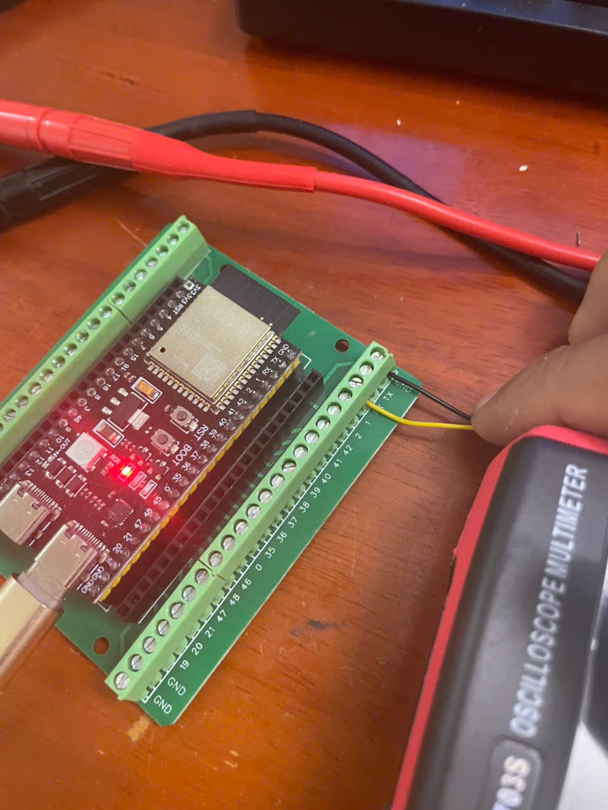
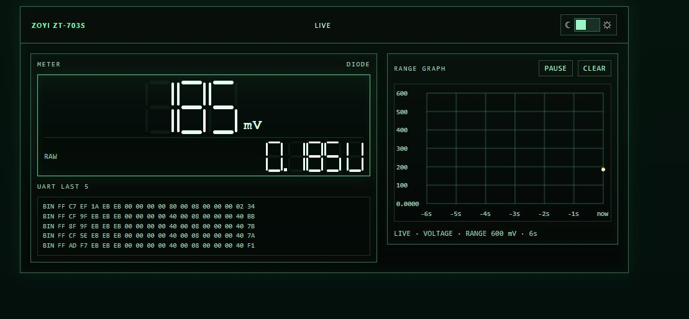
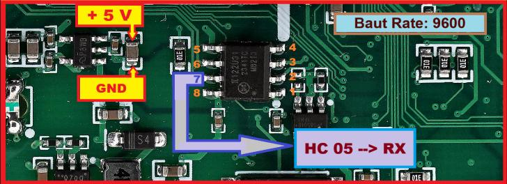

# ESP32-S3 VOM 703S Dashboard

This project turns an **ESP32-S3** into a **UART-to-Web bridge** for a **ZOYI ZT-703S** multimeter. It receives measurement data from the meter over UART and serves a live browser dashboard over Wi-Fi.

## Hardware setup

## Web dashboard

The ESP32-S3 hosts a neon-style dashboard showing the current reading, received UART frames, and a short history graph.

## Wiring

| ZOYI 703S | ESP32-S3 DevKitC-1 | Purpose |
| --- | --- | --- |
| Meter UART TX | GPIO44 (U0RXD) | UART measurement data |
| Meter GND | GND | Common ground |

> **Important:** Check the meter UART TX logic voltage before connecting it to the ESP32-S3. ESP32-S3 GPIO inputs are **not 5 V tolerant**; use level shifting if the meter's UART output exceeds 3.3 V. Do not connect ESP32 TX to the meter unless you specifically need and understand its two-way protocol. This project only reads data from the meter.

### Meter UART connection reference

The following image identifies the meter's UART connection area and indicates a **9600 baud** rate. Verify pad identification on your exact meter hardware revision before soldering.

**Wiring status in the pictured setup:** meter TX to ESP32 GPIO44 (RX), with a shared GND.

## Network and data stream

- **Wi-Fi mode:** ESP32-S3 Access Point (AP)
- **SSID:** `VOM-703S`
- **Password:** `zoyi703s123`
- **Dashboard:** `http://192.168.4.1/`
- **WebSocket:** `ws://192.168.4.1:81/`
- **UART baud rate:** `9600` (per the annotated meter reference; configure firmware accordingly)
- **Data format:** the pictured dashboard displays hexadecimal/binary UART frames; **do not assume the meter sends plain-text readings**.

## Quick start

1. Copy this project folder into a PlatformIO project, or place this README and the `docs/images/` directory into your existing project.
2. Install the **PlatformIO** extension in Visual Studio Code.
3. Open the firmware project and select **Upload**.
4. Connect to Wi-Fi SSID `VOM-703S` with password `zoyi703s123`.
5. Open `http://192.168.4.1/` in a browser.
6. To run the optional PC client, use `python pc_app/app_client.py` if that script is included in your firmware repository.

## COM port note

`COM3` is an example Windows serial-port name used to flash firmware or read serial-monitor logs. It is **not** the ESP32's Wi-Fi endpoint. The browser dashboard and PC client access the ESP32 via its AP and WebSocket server.

